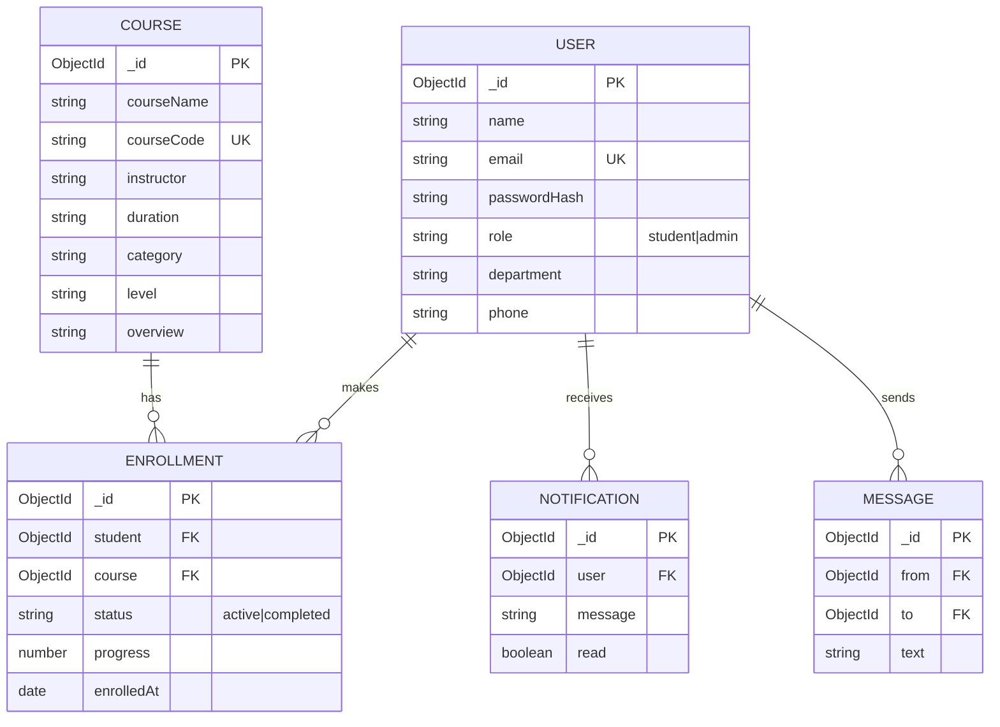

# EduSphere

A full-stack web application where students register, log in, browse and enroll in courses,
and admins manage courses and students. Includes JWT authentication, role-based access,
MongoDB persistence and real-time notifications/chat with Socket.IO.

## Problem Statement
Colleges and training institutes still manage course catalogues and enrollments with spreadsheets
and messages. This project gives students one place to discover courses, enroll, track progress and
get certificates, and gives admins one place to manage courses, students and enrollments.

## Target Users
| User | Needs |
|------|-------|
| Student | Register/login, browse courses, enroll/drop, track progress, get certificate, get notified, chat |
| Admin | Add/edit/delete courses, view/delete students, view enrollments, receive enrollment alerts |

## Features
- Registration & login (client-side + server-side validation)
- JWT authentication, protected routes, student/admin roles
- EduSphere (CRUD, admin only) and public course browsing
- Enrollment: enroll, drop, mark complete, certificate
- Student & admin dashboards
- Real-time notifications (new course, enrollment) and 1-to-1 chat (Socket.IO) with online status
- Security: bcrypt password hashing, helmet, CORS allow-list, rate-limited auth, input sanitising, central error handling
- Responsive UI (desktop / tablet / mobile)

## Tech Stack
React 19 + Vite, React Router, Context API, Axios, Socket.IO client ·
Node.js, Express 5, Mongoose, MongoDB, JWT, bcryptjs, Socket.IO

## Folder Structure
```
EduSphere/
├── backend/
│   ├── config/db.js              # MongoDB connection
│   ├── controllers/              # request handlers
│   ├── middleware/               # auth, roles, validation, sanitize, errors
│   ├── models/                   # User, Course, Enrollment, Notification, Message
│   ├── routes/                   # auth, courses, students, enrollments, notifications, messages
│   ├── services/                 # business logic
│   ├── seed/                     # sample courses + seed script
│   ├── socket.js                 # Socket.IO (JWT-secured)
│   ├── server.js                 # entry point
│   └── .env.example
├── react-frontend/
│   └── src/ (api, auth, components, context, pages, services, styles, utils)
├── mock-api/db.json              # earlier JSON-Server mock (Task 7)
└── README.md
```

## Setup (local)
Prerequisites: Node 18+ and MongoDB running locally (or a MongoDB Atlas URI).

```bash
# 1) Backend
cd backend
npm install
cp .env.example .env        # then edit JWT_SECRET, ADMIN_REGISTRATION_KEY, MONGO_URI
npm run seed                # sample courses + default admin
npm run dev                 # http://localhost:5000

# 2) Frontend (new terminal)
cd react-frontend
npm install
cp .env.example .env
npm run dev                 # http://localhost:5173
```

## REST API (also available under /api/v1/...)
| Method | Endpoint | Access |
|--------|----------|--------|
| GET | `/` , `/api/health` | public |
| POST | `/api/auth/register` , `/api/auth/login` | public |
| GET | `/api/auth/me` | logged in |
| GET | `/api/courses` , `/api/courses/:id` | public |
| POST / PUT / DELETE | `/api/courses` , `/api/courses/:id` | admin |
| GET | `/api/students` | admin |
| GET / PUT | `/api/students/:id` | admin or that student |
| DELETE | `/api/students/:id` | admin |
| POST | `/api/enrollments` | student |
| GET | `/api/enrollments/my` | student |
| PATCH | `/api/enrollments/:id/complete` | student |
| GET | `/api/enrollments` | admin |
| DELETE | `/api/enrollments/:id` | student (own) / admin |
| GET / PATCH | `/api/notifications`, `/api/notifications/read-all`, `/api/notifications/:id/read` | logged in |
| GET | `/api/messages/contacts`, `/api/messages/:userId` | logged in |

Socket events: `notification`, `chat:send`, `chat:message`, `chat:typing`, `presence`, `presence:list`.

## Database Schema (ER diagram)

(`ENROLLMENT` has a unique index on `student + course`.)

## Deployment
- **Database:** MongoDB Atlas (free tier) – copy the connection string.
- **Backend (Render):** root `backend`, build `npm install`, start `npm start`. Env vars: `MONGO_URI`, `JWT_SECRET`, `JWT_EXPIRES_IN`, `CLIENT_URL` (your Vercel URL), `ADMIN_REGISTRATION_KEY`, `NODE_ENV=production`.
- **Frontend (Vercel/Netlify):** root `react-frontend`, build `npm run build`, output `dist`. Env vars: `VITE_API_URL=https://<backend>/api/v1`, `VITE_SOCKET_URL=https://<backend>`. Add a rewrite of all paths to `/index.html` (a `vercel.json` is included).

## Live URLs
- Frontend: _add after deploy_
- Backend/API: _add after deploy_
